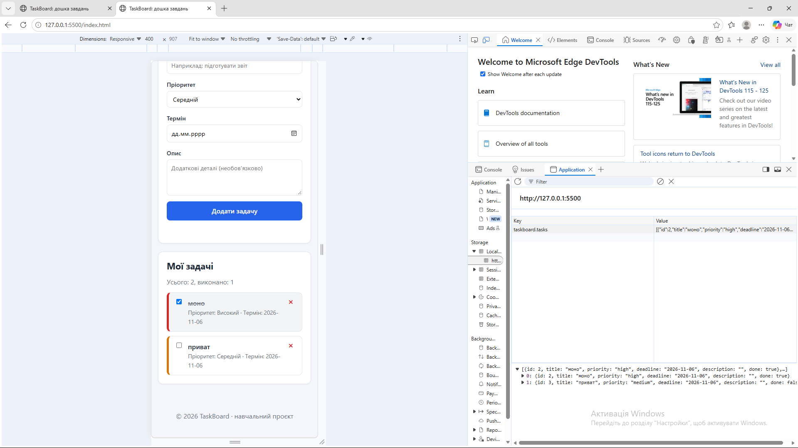
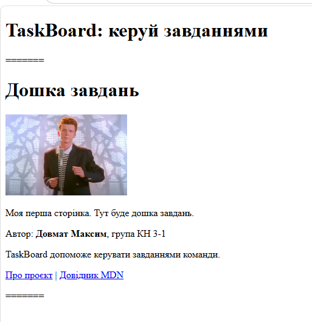

# TaskBoard

**TaskBoard** — це навчальний веб-застосунок для керування списками задач із підтримкою адаптивного верстання та локальним збереженням даних у браузері.


**Виконавець: Максим Довмат

**Група: КН 3-1 (спеціальність «Комп'ютерні науки»)
---

## 🚀 Функціональність

- ➕ **Додавання задач:** створення задач із назвою, пріоритетом (низький, середній, високий), терміном виконання та розширеним описом.
- 🔍 **Валідація форми:** автоматична перевірка обов'язкових полів.
- ✅ **Статус виконання:** перемикання статусу задачи за допомогою чекбокса з візуальним закресленням тексту.
- 🗑️ **Видалення:** швидке вилучення задач зі списку.
- 📊 **Інтерактивний лічильник:** підрахунок загальної кількості та виконаних завдань у реальному часі.
- 💾 **Збереження стану (localStorage):** всі задачі зберігаються в браузері й відновлюються після оновлення сторінки (`F5`).
- 📱 **Адаптивний дизайн:** коректне відображення на мобільних пристроях (від 390px) та десктопах завдяки Flexbox і Media Queries.

---

## 🛠️ Технології

- **HTML5:** семантичні теги (`<header>`, `<nav>`, `<main>`, `<article>`, `<section>`, `<footer>`).
- **CSS3:** Flexbox-контейнери, кастомні змінні (`:root`), адаптивні медіа-запити (`@media`).
- **JavaScript (ES6+):** маніпулювання DOM, обробка подій, делегування подій (`click`), збереження через `localStorage` та `JSON`.
- **Git & GitHub:** версійність коду, гілкова розробка (`html-pages`, `flex-form`, `js-tasks`), злиття через Pull Requests.

---

## 📋 План розвитку

- [x] Репозиторій і перша сторінка (W-07)
- [x] Адаптивна верстка та форма (HTML + CSS + Flexbox) (W-10)
- [x] Інтерактивність і збереження даних (JavaScript + DOM + localStorage) (W-12)
- [ ] Серверна частина на Flask
- [ ] База даних та користувачі
- [ ] Docker
- [ ] REST API і тести
- [ ] Публікація онлайн

---

## 📸 Інтерфейс застосунку



---

## ⚙️ Як запустити проєкт

1. **Склонувати репозиторій:**
   ```bash
   git clone [https://github.com/maks1dv/veb-tehnologii.git](https://github.com/maks1dv/veb-tehnologii.git)



